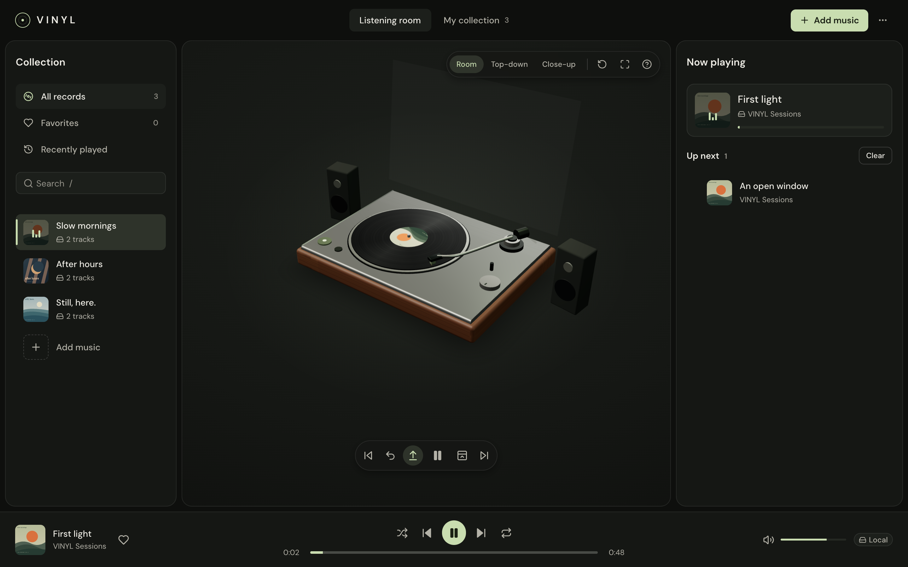
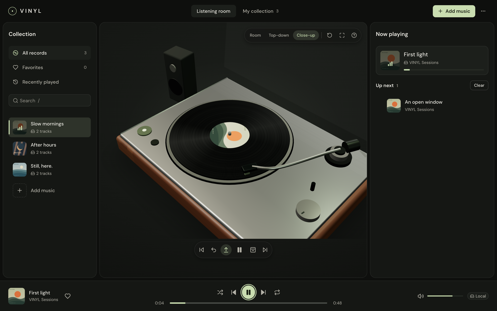
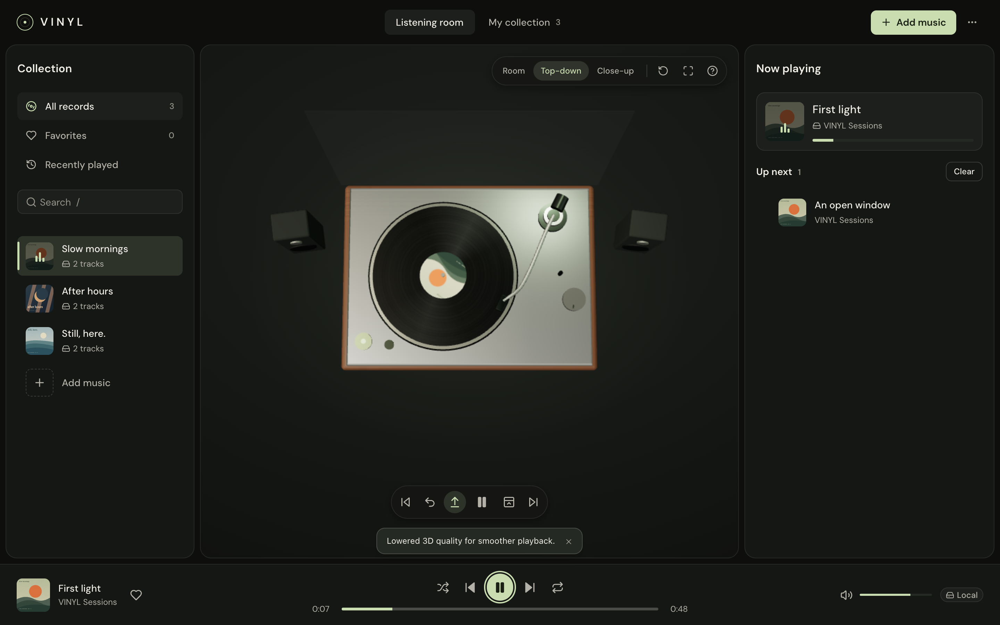
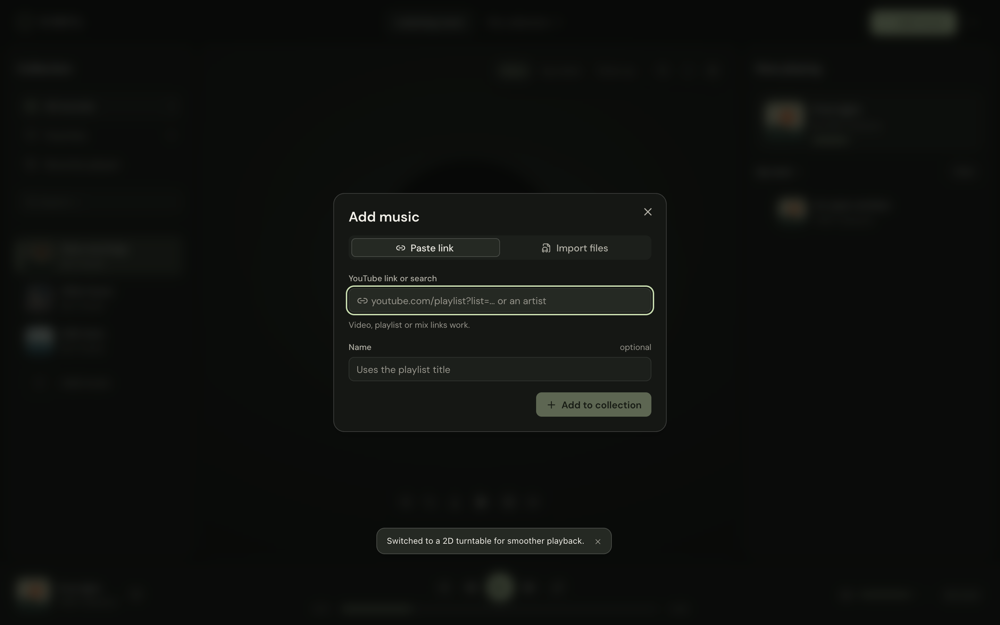
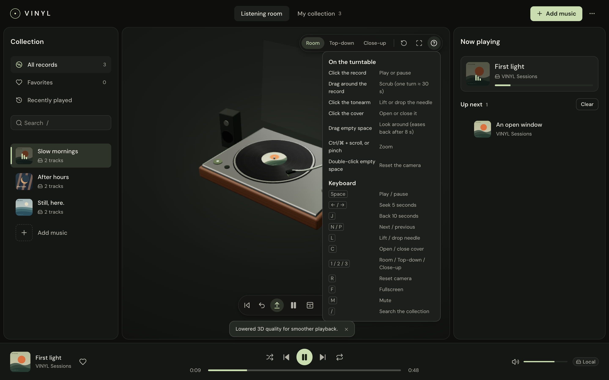
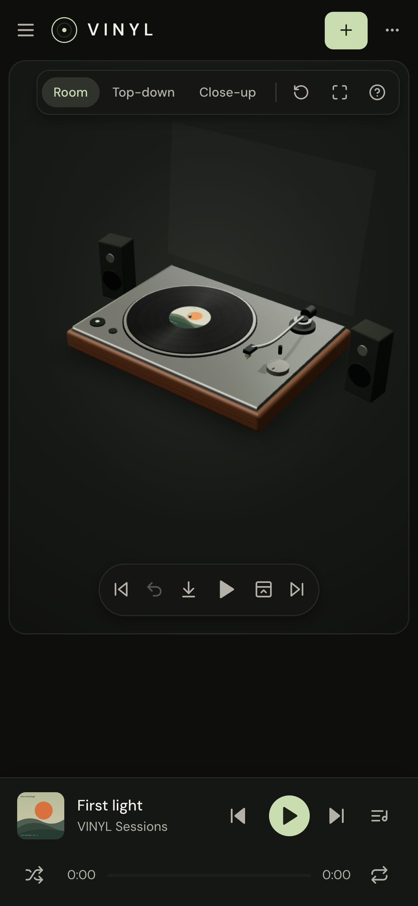
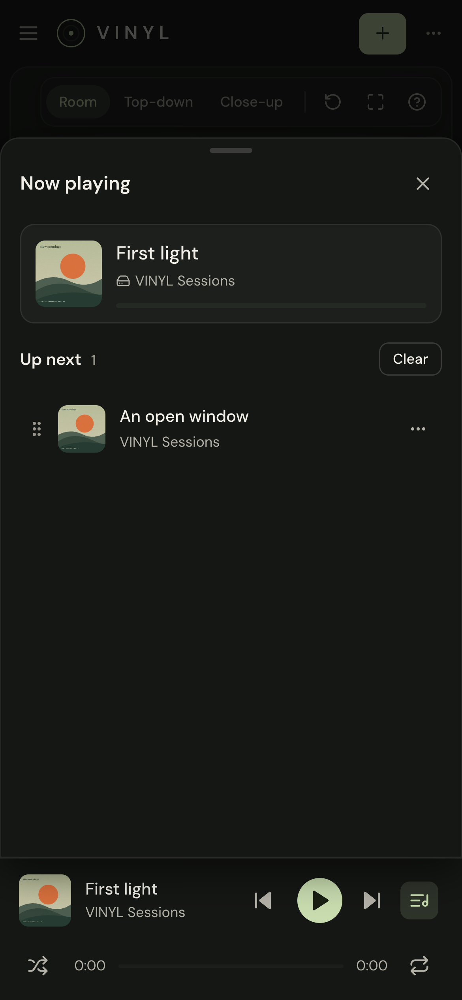

# VINYL

A calm, analog-feeling listening room in the browser. Put a record on a 3D turntable, play your own audio files or YouTube links, and build a queue that remembers where you left off.



Built with React 19, TypeScript, Vite, React Three Fiber (Three.js + drei), Tailwind CSS v4, shadcn/ui on Radix, Zustand, Sonner and IndexedDB.

## Features

- **A turntable you can touch.** Click the record to play or pause, drag around it to scrub, click the tonearm to lift or drop the needle, click the dust cover to open or close it. There are no modes to switch between.
- **A camera you can't get lost in.** Room, Top-down and Close-up presets with smooth transitions. Dragging empty space looks around within fixed limits, and the view eases back to the preset after 8 seconds.
- **One queue for everything.** Local files and YouTube videos share the same queue: shuffle, repeat, drag to reorder, play next, rename, remove, and clear with undo. The queue and position survive a refresh.
- **YouTube that keeps playing.** Paste a video, playlist or mix link. Videos whose owners block embedding are skipped automatically (or marked, if you picked them yourself), with an "Open on YouTube" link.
- **Local audio with real crossfades.** Two decks, equal-power crossfades, a 3-band EQ, stereo balance and optional vinyl crackle. Files stay in your browser and are never uploaded.
- **Keyboard-first and accessible.** Every action works from the 2D controls and the keyboard, with visible focus, labeled controls, WCAG AA contrast and reduced-motion support.
- **Works on slow devices too.** Renders on demand, steps down quality if playback drops below 30 fps, and falls back to a 2D turntable when WebGL isn't available.

## Screenshots

| Close-up | Top-down |
| --- | --- |
|  |  |

| Add music | Gestures & shortcuts |
| --- | --- |
|  |  |

| Mobile | Mobile queue |
| --- | --- |
|  |  |

## Getting started

Requires Node.js 20 or newer.

```sh
npm install
npm run dev
```

Open http://127.0.0.1:5173. Use the dev server address rather than opening `index.html` directly: the YouTube player needs a real origin.

| Command | What it does |
| --- | --- |
| `npm run dev` | Start the dev server |
| `npm test` | Run the unit tests (Vitest) |
| `npm run build` | Type-check and build to `dist/` |
| `npm run preview` | Serve the production build |

### YouTube API key (optional)

Without a key, video and playlist links still work. With a key, VINYL can also search, show a preview before adding, and leave out videos that can't be embedded.

1. In [Google Cloud Console](https://console.cloud.google.com/), create a project and enable **YouTube Data API v3**.
2. Under **APIs & Services → Credentials**, create an API key.
3. Restrict it: **Websites** → `http://127.0.0.1:5173/*`, `http://localhost:5173/*` and your production domain; **API restrictions** → YouTube Data API v3 only.
4. Copy the example env file and paste the key in:

   ```sh
   cp .env.example .env.local
   # VITE_YOUTUBE_API_KEY=your-key
   ```

5. Restart `npm run dev`.

`.env.local` is git-ignored. Vite builds `VITE_*` variables into the browser bundle, so the key is visible to visitors; the website restriction is what protects it. When deploying (for example to Vercel), add `VITE_YOUTUBE_API_KEY` in the host's environment settings and redeploy.

| You paste | With a key | Without a key |
| --- | --- | --- |
| A playlist (`list=PL…`) | Full playlist; private and non-embeddable videos removed up front | Video IDs read from the player; blocked videos skipped when reached |
| A video or mix (`list=RD…`) | That video plus more from the same artist | That video only |
| Plain text | Search results | Not available |

Searches cost 100 of the default 10,000 daily quota units; everything else costs 1.

## Using VINYL

**On the turntable**

| Gesture | Action |
| --- | --- |
| Click / tap the record | Play or pause |
| Drag around the record | Scrub (one turn ≈ 30 seconds) |
| Click the tonearm | Lift or drop the needle |
| Click the dust cover | Open or close it |
| Drag empty space | Look around (eases back after 8 s) |
| Ctrl/⌘ + scroll, or pinch | Zoom |
| Double-click empty space | Reset the camera |

**Keyboard**

| Key | Action |
| --- | --- |
| Space | Play / pause |
| ← / → | Seek 5 seconds |
| J | Back 10 seconds |
| N / P | Next / previous |
| L | Lift / drop the needle |
| C | Open / close the cover |
| 1 / 2 / 3 | Room / Top-down / Close-up |
| R | Reset the camera |
| F | Fullscreen |
| M | Mute |
| / | Search the collection |
| Alt + ↑ / ↓ | Move the focused queue item |

## How it works

- **The app owns the queue.** YouTube's generated mixes can't play in embedded players, so VINYL never hands a playlist to YouTube. One official, visible player plays a single video at a time with `loadVideoById()`, and the app advances when it ends.
- **Embed errors are handled, not shown as a black box.** Errors 2, 100, 101 and 150 skip to the next track after a second with one short message. A song you clicked yourself stays put instead, so it never jumps to something you didn't choose.
- **The YouTube player is always visible while it plays,** at least 200×200 px as YouTube's terms require: above the queue on desktop, under the collection on tablets, and under the turntable on phones.
- **Fades.** YouTube tracks fade out, switch, then fade in (1–10 s each). Local files crossfade with real overlap through the Web Audio graph.
- **Storage.** Collections, favorites, settings and imported files live in IndexedDB. The queue, position and last camera view live in localStorage.

## Project structure

```
src/
  App.tsx                     Layout, global shortcuts, dialogs
  theme.css, styles.css       Design tokens (the only place colors are defined) and layout styles
  components/
    ui/                       shadcn/ui components, restyled to the tokens; controls.tsx composes them
    PlaylistSidebar.tsx       Collection, search, rename, favorites, recent
    QueuePanel.tsx            Now playing card and Up next queue (drag to reorder)
    MediaDock.tsx             YouTube mini-player
    PlaybackControls.tsx      Bottom player bar
    TurntableWorkbench.tsx    Camera toolbar, transport row, first-run hint
    AddMusicDialog.tsx        Paste link (with preview) / import files
  scene/
    TurntableScene.tsx        3D model, hit areas, rendering, 2D fallback
    useTurntableControls.ts   Interaction tuning, camera rig, direct-manipulation hook
  audio/
    PlaybackController.ts     Transport, queue ownership, auto-skip, link resolving
    queue.ts                  Pure queue operations
    YouTubePlayerAdapter.ts   Official IFrame player, one video at a time
    LocalAudioAdapter.ts      Dual-deck mixer, EQ, crossfades
    TransitionManager.ts      YouTube fade envelope
  lib/
    youtubeApi.ts             YouTube Data API v3 resolver
    queueStorage.ts, uiStorage.ts, persistence.ts
tests/                        Unit tests (queue, controller, YouTube adapter and API, transitions, persistence, gestures)
qa/                           Browser checks (Playwright; run against `npm run dev`)
```

Interaction feel (hit-area size, orbit limits, idle return, scrub speed, parallax) is tuned in the `TUNING` block at the top of `src/scene/useTurntableControls.ts`.

## Testing

```sh
npm test                          # 111 unit tests
npm run dev                       # then, in another terminal:
node qa/turntable-check.mjs       # 3D interaction: mouse, touch, camera, keyboard, 2D fallback
node qa/design-check.mjs          # contrast, focus rings, labels, overlap at 1440 and 390 px
node qa/flows-check.mjs           # add music, rename, clear + undo, duplicates, persistence
node qa/readme-shots.mjs          # regenerate the screenshots above
```

The QA scripts need Google Chrome installed.

## Credits

The six 48-second ambient tracks and three cover illustrations are original works made for this project. The turntable, its materials and textures are generated in code; no external model files are used.
